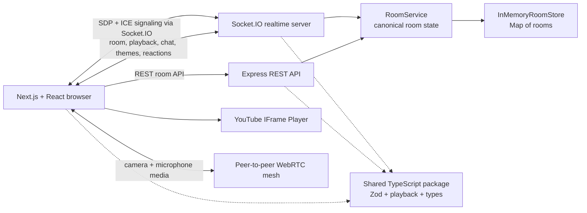

# Cove

### Your little corner, together.

Cove is a cozy, private watch-party experience for sharing YouTube videos with people who are somewhere else. Create a room, send the link, and settle in with synchronized playback, room chat, lightweight reactions, and optional peer-to-peer video calling.

> Built for the moments when distance should not mean watching alone.

[Browse the source](.) · [Read the deployment audit](DEPLOYMENT_AUDIT.md) · [Read the WebRTC security audit](SECURITY_VERIFICATION.md)


There is no hosted demo URL in this repository yet. Cove currently runs as a split frontend + realtime backend application; the local setup below is the canonical way to try it.

## Why Cove exists

Watching a video together remotely should feel like sharing a sofa, not coordinating timestamps in one window while chatting in another. Cove keeps the small things in one calm room: the video stays central, everyone receives the same playback state, and conversation can stay close by without taking over the screen.

The product is deliberately lightweight: no account system, no public room directory, and no permanent profile. A room is a temporary little corner for the people who have its link.

## Features

### Implemented

- **Create and join rooms** — create a link-only room and invite up to four connected participants. Joining only requires a temporary display name.
- **Synchronized YouTube playback** — participants can load a YouTube URL and play, pause, or seek together. The server owns the canonical playback state, while clients correct meaningful drift for late joiners and reconnects.
- **Room chat** — send room-scoped messages with a capped in-memory history. Messages are sanitized before they are stored and escaped before they are rendered.
- **Session restore and host transfer** — a `sessionStorage` token lets a refresh reconnect the same participant. If the host leaves, the oldest connected participant becomes host.
- **Ephemeral room lifecycle** — rooms and chat live in memory and are deleted after the configured empty-room timeout; the default is 15 minutes.
- **Optional video calling** — camera and microphone can be enabled from the room. Media travels peer-to-peer through browser WebRTC connections; the backend relays signaling only.
- **Shared room themes** — the host can set one atmosphere for the whole room: Cozy Cabin, Rainy Evening, Midnight Cinema, or Sunday Morning. The selected theme is part of the room snapshot and reaches new and reconnecting participants.
- **Lightweight reactions** — Heart, Laugh, Surprised, and Thumbs-up are transient Socket.IO events. They appear in a small reaction area outside the video and are rate-limited so the player remains the focus.
- **Responsive, accessible interface** — the Cove frontend uses warm design tokens, keyboard focus states, touch-sized controls, reduced-motion support, and mobile tabs for the room's supporting panels.

### Intentionally not included yet

- A database-backed room store or multi-instance realtime deployment.
- TURN infrastructure for WebRTC connections behind restrictive NATs.
- A hosted production demo, CI workflow, or published test-coverage report.

## How it works

1. Open Cove and create a room. The backend returns an unguessable room ID and a one-time creator token.
2. Enter a temporary display name. The creator claims the initial host role when joining.
3. Share the room link with up to three other people.
4. Paste a YouTube URL into the room. Playback actions are broadcast through the server and reconciled on each client.
5. Chat, react to a moment, or turn on a camera if the group wants to be more present.
6. The host can change the shared room atmosphere without changing the video itself.

## Product preview

The landing page contains a self-contained visual preview of a Cove room, but this repository does not currently include screenshots of the running application. Once a hosted environment exists, the most useful additions would be:

- the landing page and create/join flow;
- an active room with the player, participants, and chat;
- the room theme picker and reaction area.

No screenshot paths are linked here until real captures are added.

## Tech stack

| Area | Technology | Role |
| --- | --- | --- |
| Frontend | Next.js 15 App Router | Renders the web application and route structure in `frontend/`. |
| UI runtime | React 19 | Provides the client-side room state and interactive components. |
| Language | TypeScript 5.8 | Used across the frontend, backend, and shared package. |
| Styling | Tailwind CSS 4 + CSS variables | Provides utility styling and centralized Cove/theme tokens. |
| Motion and icons | Framer Motion + Lucide React | Supplies restrained transitions and consistent interface icons. |
| Backend | Node.js + Express 4 | Hosts REST endpoints and the long-lived HTTP server. |
| Realtime | Socket.IO 4 | Carries room state, playback, chat, reactions, and WebRTC signaling events. |
| Validation | Zod 3 | Validates REST and Socket.IO payloads in the shared package and server. |
| Room storage | In-memory `Map` store | Holds rooms, participants, playback, chat, and themes for the lifetime of the process. |
| Video | YouTube IFrame Player API | Embeds the real YouTube player while Cove synchronizes its state. |
| Calling | Browser WebRTC + public Google STUN | Connects up to four participants in a peer mesh; the server relays signaling only. |
| Tests | Vitest 3 | Runs shared playback/validation tests and server room/socket tests. |
| Production frontend | Vercel-compatible Next.js app | `frontend/vercel.json` builds the shared package before the frontend. |

## Architecture overview

Cove is a small npm-workspaces monorepo with a deliberate split between the browser and the realtime process:

- `frontend/` owns the App Router pages, UI, YouTube player integration, browser session tokens, Socket.IO client, and WebRTC peer connections.
- `server/` owns room creation, room membership, host transfer, playback state, chat storage, theme permissions, expiry cleanup, and Socket.IO event routing.
- `shared/` owns types, Zod schemas, YouTube URL parsing, sanitization helpers, playback math, and WebRTC signaling schemas used by both sides.



### Room lifecycle and persistence

`RoomService` is the business-logic boundary. `InMemoryRoomStore` keeps each room in a process-local `Map`; there is no Prisma schema, database, migration, seed, or permanent room record in this repository. A room is marked empty when its last participant leaves or disconnects and is deleted after `ROOM_EMPTY_TIMEOUT_MS`.

The browser keeps only temporary session and creator tokens in `sessionStorage`. Public room snapshots intentionally omit server-only `sessionToken` and socket IDs.

### Playback synchronization

1. A participant's play, pause, seek, or set-video action is validated and sent to `RoomService`.
2. The server stores `videoId`, status, position, timestamp, and the participant that last updated it.
3. A playing position is calculated from the stored position plus elapsed server time.
4. Socket.IO broadcasts the new public room snapshot to everyone in the room.
5. The YouTube hook applies the state and corrects local drift when it exceeds 1.25 seconds. A sync guard prevents programmatic corrections from echoing back as new user actions.

### Themes and reactions

Themes are shared room state, not a local preference. The host-only `room:set-theme` event updates the room's `theme` field and broadcasts `room:theme-updated`; join and reconnect snapshots include the current value. The four theme palettes are implemented as CSS variables on the room root.

Reactions are transient `reaction:send` / `reaction:received` events. They do not mutate room history or playback. The server validates the supported reaction set, scopes events to the sender's room, derives sender identity from the socket session, and ignores bursts above the per-socket reaction limit.

### WebRTC behavior

The optional camera feature uses a small peer mesh capped by the four-person room limit. Express and Socket.IO relay SDP offers, answers, ICE candidates, and media-state flags; camera frames and microphone audio stay in browsers and travel peer-to-peer. The current configuration includes public Google STUN servers but no TURN service.

## Project structure

```text
cove/
├── frontend/
│   ├── app/
│   │   ├── page.tsx                 # Landing page
│   │   └── room/
│   │       ├── create/page.tsx      # Room allocation route
│   │       └── [roomId]/page.tsx    # Room route + providers
│   ├── components/
│   │   ├── landing/                 # Cove landing and room preview
│   │   ├── room/                    # Player, chat, themes, reactions, WebRTC UI
│   │   └── ui/                      # Buttons, inputs, modals, loading, branding
│   ├── lib/
│   │   ├── api/                    # REST room client
│   │   ├── room/                   # Room React state and session storage
│   │   ├── socket/                 # Socket.IO client
│   │   ├── youtube/                # Player and oEmbed helpers
│   │   └── webrtc/                 # Media, peer, and signaling services
│   ├── public/                     # Brand mark and existing visual assets
│   ├── app/globals.css             # Cove tokens and theme variables
│   └── vercel.json                 # Monorepo-aware Vercel build config
├── server/
│   └── src/
│       ├── rooms/                  # Room store, service, lifecycle, playback
│       ├── socket/                 # Socket.IO event handlers and tests
│       ├── config.ts               # Environment-backed server settings
│       └── server.ts               # Express + HTTP + Socket.IO entry point
├── shared/
│   └── src/
│       ├── types.ts                # Public room, theme, participant, playback types
│       ├── validation.ts           # Shared room/chat/theme/reaction schemas
│       ├── playback.ts              # Canonical playback math
│       ├── youtube.ts                # YouTube URL/video ID parsing
│       ├── webrtc.ts                 # Signaling payload schemas and limits
│       └── *.test.ts                 # Shared behavior tests
├── scripts/free-port.js             # Development port cleanup helper
├── .env.example                     # Backend + frontend local environment reference
├── frontend/.env.local.example      # Next.js public variables
├── DEPLOYMENT_AUDIT.md              # Deployment and operational findings
├── SECURITY_VERIFICATION.md          # WebRTC security review
└── package.json                     # npm workspaces and root scripts
```

## Getting started

### Prerequisites

- Node.js 20 or newer is the documented project prerequisite. The repository does not declare an `engines` field, so use a current LTS release.
- npm 10 or newer.
- A modern browser with JavaScript, WebSocket support, and WebRTC support if you want to try video calling.
- Network access to YouTube if you want to load a video.

### 1. Clone the repository

This workspace does not contain a Git remote URL, so use the clone URL for the repository host where Cove is published:

```bash
git clone <repository-url>
cd cove
```

If you already have the repository locally, start from its root directory.

### 2. Install dependencies

```bash
npm install
```

The root `package.json` defines npm workspaces for `shared`, `server`, and `frontend`, so install once from the repository root.

### 3. Configure the environment

Create the backend environment file and the frontend's local environment file:

```bash
cp .env.example .env
cp frontend/.env.local.example frontend/.env.local
```

On Windows PowerShell, use:

```powershell
Copy-Item .env.example .env
Copy-Item frontend/.env.local.example frontend/.env.local
```

The checked-in examples point both clients to the local realtime server at `http://localhost:4001` and allow the local Next.js app at `http://localhost:3000`.

### 4. Build the shared package once

The frontend and server import the compiled shared workspace package. Build it before the first direct workspace run:

```bash
npm run build -w shared
```

The root development and production build scripts also build `shared` in the correct order.

### 5. Start Cove

```bash
npm run dev
```

This starts the persistent Express + Socket.IO server and the Next.js frontend concurrently. With the default environment, open:

- Cove: <http://localhost:3000>
- Backend health check: <http://localhost:4001/health>

The health endpoint should return JSON with `ok: true`.

### Database, migrations, and seed data

Cove does not use a database or Prisma in the current implementation. Room state, chat, playback, themes, and participant presence are held in memory by the backend process. There are no migration or seed commands to run.

### Troubleshooting

| Symptom | What to check |
| --- | --- |
| The frontend cannot reach the server | Confirm the backend is listening on port `4001`, then check `NEXT_PUBLIC_API_URL` and `NEXT_PUBLIC_SOCKET_URL`. |
| CORS errors in the browser | Make sure `CLIENT_ORIGIN` exactly matches the browser origin, including protocol and port. Multiple origins are comma-separated with no required spaces. |
| `EADDRINUSE` on port 4001 | Stop the process using the port or run the root `predev` script, which invokes `scripts/free-port.js`. |
| A room says it is missing or expired | Rooms are process-local and ephemeral. A backend restart removes them, and an empty room expires after the configured timeout. |
| Video calling cannot connect | Use HTTPS/WSS in deployed environments, allow camera/microphone permissions, and remember that the current project has STUN but no TURN fallback. |
| Production build warns about localhost | Set both public frontend URLs to the deployed backend URL before building the frontend. |
| Frontend lint asks to configure ESLint | The existing `next lint` script is deprecated by the installed Next.js version and currently opens the interactive ESLint migration flow. This is a known repository tooling gap, not a passing lint check. |

## Environment variables

The backend loads `.env` from the repository root. Next.js loads `frontend/.env.local`. Values prefixed with `NEXT_PUBLIC_` are intentionally public and are bundled into the browser; do not put secrets in them.

| Variable | Required? | Default | Purpose / format |
| --- | --- | --- | --- |
| `PORT` | Optional locally; supplied by most hosts in production | `4001` | Port for Express and Socket.IO. |
| `NODE_ENV` | Optional | `development` | Controls development-only server logging and environment behavior. |
| `CLIENT_ORIGIN` | Required for a deployed backend | `http://localhost:3000` | Comma-separated browser origins allowed by Express and Socket.IO CORS. Use exact `https://...` origins in production. |
| `ROOM_EMPTY_TIMEOUT_MS` | Optional | `900000` | How long an empty room survives, in milliseconds. The default is 15 minutes. |
| `ROOM_CLEANUP_INTERVAL_MS` | Optional | `60000` | How often the server scans for expired rooms, in milliseconds. |
| `MAX_PARTICIPANTS_PER_ROOM` | Optional | `4` | Connected participant capacity per room. The UI and shared constants are designed around four people. |
| `MAX_CHAT_MESSAGES` | Optional | `200` | Maximum in-memory chat messages retained per room. |
| `NEXT_PUBLIC_API_URL` | Required for a deployed frontend | `http://localhost:4001` | Public base URL for REST requests such as room creation and snapshots. |
| `NEXT_PUBLIC_SOCKET_URL` | Required for a deployed frontend | `http://localhost:4001` | Public base URL used by the Socket.IO client. |

## Available scripts

Run root commands from the repository root. Workspace commands use npm's `-w` selector.

| Command | What it does |
| --- | --- |
| `npm run dev` | Builds `shared`, then starts the server and frontend concurrently for local development. |
| `npm run build` | Builds `shared`, then TypeScript-compiles `server`, then creates the optimized Next.js frontend build. |
| `npm run start` | Starts the built server and frontend concurrently. Use this on one persistent machine, not as a Vercel serverless command. |
| `npm test` | Runs the shared Vitest suite followed by the server Vitest suite. |
| `npm run build -w shared` | Compiles the shared TypeScript package. |
| `npm run build -w server` | Compiles the backend to `server/dist`. |
| `npm run build -w frontend` | Creates the production Next.js build. |
| `npm run test -w shared` | Runs shared playback and validation tests. |
| `npm run test -w server` | Runs room-service and Socket.IO handler tests. |
| `npm run dev -w server` | Runs the backend watcher with `tsx`. |
| `npm run dev -w frontend` | Runs the Next.js development server. |
| `npm run lint -w frontend` | Present in the frontend package, but currently invokes the installed Next.js deprecated interactive lint migration flow because no ESLint configuration is checked in. |

## API reference

The backend exposes a small REST surface. Room membership, playback, chat, theme, reactions, and WebRTC signaling are Socket.IO concerns.

### REST endpoints

| Method | Path | Purpose | Response |
| --- | --- | --- | --- |
| `GET` | `/health` | Check that the process is alive and report the in-memory room count. | `{ "ok": true, "rooms": number }` |
| `POST` | `/api/rooms` | Allocate a new empty room. | `{ "roomId": string, "creatorToken": string }` |
| `GET` | `/api/rooms/:roomId` | Fetch a public room snapshot before joining. | `PublicRoom` or a structured 400/404 error. |

Room IDs are 12-character alphanumeric values. The public snapshot contains participants, chat, playback, host ID, and theme; server-only session tokens and socket IDs are omitted.

### Socket.IO events

All room events are validated with shared Zod schemas and must use the socket's current room identity.

| Direction | Event | Purpose |
| --- | --- | --- |
| Client → server | `room:join` | Join with a display name and optional session/creator token. |
| Client → server | `room:reconnect` | Restore a participant using its session token. |
| Client → server | `room:leave` | Leave the current room. |
| Client → server | `room:set-theme` | Host-only update for one of the four shared themes. |
| Server → client | `room:state` | Send the authoritative snapshot after join or reconnect. |
| Server → room | `room:participant-joined`, `room:participant-left`, `room:host-changed` | Keep presence and host metadata current. |
| Client → server | `playback:set-video`, `playback:play`, `playback:pause`, `playback:seek` | Update the server-authoritative YouTube playback model. |
| Server → room | `playback:updated`, `playback:video-changed` | Broadcast updated playback state. |
| Client → server | `chat:send` | Send a sanitized room message; the server acknowledges success or a `RoomError`. |
| Server → room | `chat:message` | Broadcast the updated chat snapshot. |
| Client → server | `reaction:send` | Send a supported transient reaction. |
| Server → room | `reaction:received` | Broadcast emoji, server-derived participant identity, display name, and timestamp. |
| Server → room | `room:theme-updated` | Broadcast the updated public room after a host theme change. |
| Client ↔ server | `webrtc:offer`, `webrtc:answer`, `webrtc:ice-candidate` | Relay signaling to a specific connected participant. |
| Client → server / server → room | `webrtc:media-state`, `webrtc:reconnect`, `webrtc:peer-reconnected` | Coordinate camera/microphone UI state and peer recovery. |

Socket errors use `room:error` with a stable `code` and human-readable `message`. Room creation is protected by an Express rate limit; WebRTC signaling and reactions have per-socket burst limits.

## Security and design considerations

The following points are grounded in the current source and the repository's security/deployment audits:

- **No account or profile database** — display names, chat, presence, playback, and themes are scoped to an in-memory room.
- **Un-guessable room IDs** — room IDs are generated with a 12-character `nanoid` alphabet and are validated server-side.
- **Host claim protection** — the creator receives a one-time creator token; it is consumed when the creator joins and claims the initial host role.
- **Socket-bound identity** — the server derives participant identity from the joined socket session when relaying chat, reactions, and WebRTC signaling. Clients do not choose their sender identity or arbitrary target socket ID.
- **Room isolation** — playback, chat, theme, reactions, and signaling handlers require the socket's room ID to match the payload room ID.
- **Payload limits and validation** — Zod schemas validate room IDs, names, URLs, chat messages, themes, reactions, SDP, and ICE payload sizes. Express JSON bodies are capped at 16 KB.
- **Output handling** — server-only session/socket fields are stripped from public snapshots, display names are constrained, and chat is sanitized on the server and escaped in the UI.
- **Transport and browser privacy** — WebRTC media is not uploaded to Express; the backend handles signaling metadata only. Production still needs HTTPS/WSS and appropriate deployment headers.
- **CORS and headers** — Express and Socket.IO use the configured `CLIENT_ORIGIN` allowlist, and Helmet is enabled. CSP is currently disabled on the API and no Next.js CSP header is configured because the project embeds YouTube; this needs a deliberate production hardening pass.

### Known production considerations

- The in-memory room store is safe for a single backend instance only. A process restart clears all rooms, and multiple backend replicas will not share room state without a shared store and Socket.IO adapter.
- WebRTC currently uses public Google STUN servers and no TURN service, so some network topologies may fail to establish peer connections.
- HTTPS/WSS is an operational deployment requirement, not something the application enforces in code.
- Chat, playback, and some other socket events do not yet have the same per-socket rate limiting that signaling and reactions have.
- Session tokens live in `sessionStorage`; frontend XSS would make them sensitive. Keep the frontend dependencies, output handling, and deployment headers under review.

See [`SECURITY_VERIFICATION.md`](SECURITY_VERIFICATION.md) and [`DEPLOYMENT_AUDIT.md`](DEPLOYMENT_AUDIT.md) for the evidence and remaining findings.

## Deployment

Cove is intentionally split:

| Component | Recommended host | Reason |
| --- | --- | --- |
| `frontend/` | Vercel or another Next.js host | The App Router frontend has no custom server and includes a monorepo-aware `frontend/vercel.json`. |
| `server/` | Railway, Render, Fly.io, a VPS, or another persistent Node host | Express + Socket.IO requires a long-lived process, process-local room state, and a cleanup timer. |

### Frontend on Vercel

1. Import the repository and set the Vercel **Root Directory** to `frontend`.
2. Keep the checked-in `frontend/vercel.json`, which installs from the monorepo root and builds `shared` before `frontend`.
3. Set `NEXT_PUBLIC_API_URL` and `NEXT_PUBLIC_SOCKET_URL` to the public HTTPS URL of the backend.
4. Deploy the frontend.

### Backend on a persistent Node host

1. Build from the repository root:

   ```bash
   npm run build -w shared
   npm run build -w server
   ```

2. Start the compiled server with `npm run start -w server` (or `node dist/server.js` from `server/`, depending on the host's working-directory configuration).
3. Set `CLIENT_ORIGIN` to the exact frontend origin and provide the platform's `PORT`.
4. Confirm `GET /health` returns `{ "ok": true }`.
5. Run one backend instance for the MVP. Redis-backed state and a Socket.IO adapter are required before horizontal scaling.

Do not deploy `server/` as a Vercel serverless function, and do not run multiple backend replicas with the current in-memory store.

## Roadmap

### Completed in the current repository

- Link-only four-person watch rooms with session restore and host transfer.
- Server-authoritative synchronized YouTube playback.
- Ephemeral room/chat lifecycle with configurable cleanup.
- Room chat and optional peer-to-peer video calling.
- Cove visual refresh with responsive room layouts, accessible controls, and reduced-motion support.
- Four shared room themes and four lightweight, transient reactions.

### Potential next steps

- Replace `InMemoryRoomStore` with a Redis-backed store and add the Socket.IO Redis adapter for multi-instance deployment.
- Add TURN configuration and improve WebRTC reconnect diagnostics.
- Add socket-level limits for chat and playback events.
- Add a deliberate CSP/header configuration that remains compatible with the YouTube embed.
- Add CI for `npm test` and `npm run build`, plus browser-level room-flow coverage.
- Capture and publish real product screenshots once a hosted environment exists.

There are no delivery dates attached to these ideas.

## Contributing

Contributions that keep Cove calm, useful, and easy to run are welcome.

1. Fork or clone the repository and create a focused branch:

   ```bash
   git switch -c feat/your-change
   ```

2. Make the smallest change that preserves the existing room, playback, chat, WebRTC, and environment contracts.
3. Run the relevant checks before opening a pull request:

   ```bash
   npm test
   npm run build
   ```

4. Describe the user-visible behavior, the affected workspace(s), and any deployment or browser constraints in the pull request.

The repository does not currently define an enforced formatter or non-interactive frontend lint configuration. Keep TypeScript clear, reuse existing components and shared schemas, and include a focused test when a room or realtime behavior changes.

## License

No `LICENSE` file is present in the repository, so licensing information has not yet been established. Add a license before distributing Cove as an open-source package.

## Acknowledgements

Cove is built around a simple idea: technology should make spending time together feel effortless.

**Your little corner, together.**
